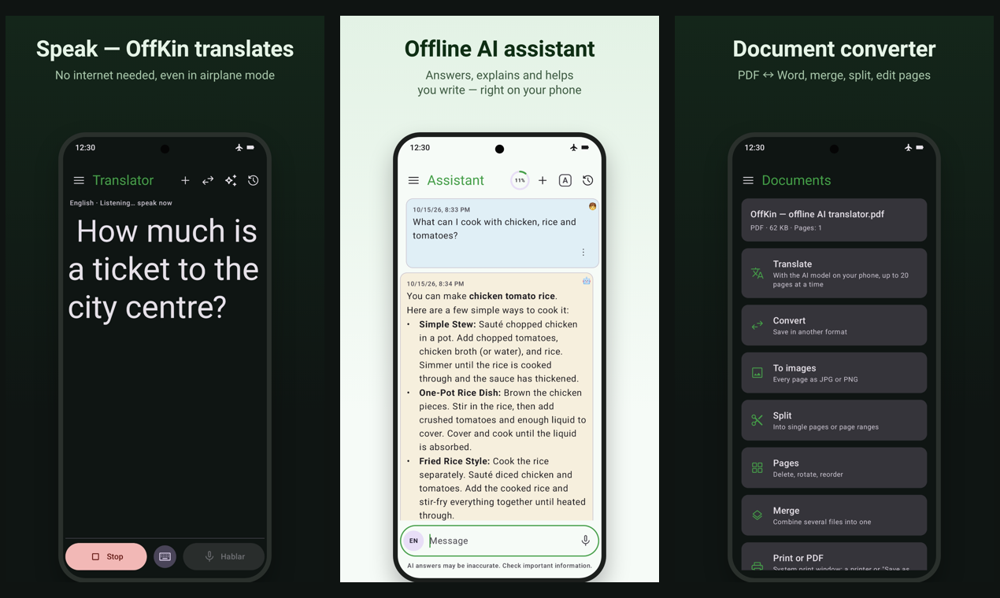
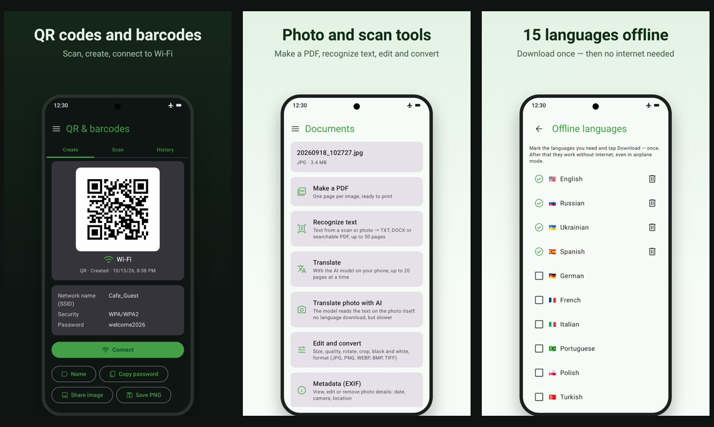

# OffKin

**Offline translator, AI assistant, document converter and QR scanner for Android.**
Everything runs on your phone, even in airplane mode. No account, no data collected.

[Google Play](https://play.google.com/store/apps/details?id=app.offkin&referrer=utm_source%3Dgithub) · [Website](https://offkin.com) · [Privacy policy](https://offkin.com/en/privacy/)

## What it does

**Translator**
- Text and voice translation in 15 languages
- Live two-way conversation: each person speaks their own language
- Translation of selected text from other apps

**AI assistant**
- Ask by text or voice and listen to the answer
- The model runs on the phone, so your questions are never sent to a server

**Document converter**
- Convert PDF, DOCX and text files, merge and split PDFs, turn pages into images
- Recognize text from scans and photos, and translate documents

**QR codes and barcodes**
- Scan and create codes
- Connect to Wi-Fi with a QR code

## Languages

English, Russian, Ukrainian, Spanish, German, French, Italian, Portuguese, Polish, Turkish, Arabic, Hindi, Japanese, Korean and Chinese.

## Requirements

- Android 11 or newer. No iPhone version yet.
- Internet is needed once, to download languages and the AI model.
- AI features: at least 4 GB of RAM for the light model (about 2.6 GB download) and 6 GB for the accurate one (about 3.7 GB).
- The AI model is compact: it doesn't know recent news and can make mistakes.

## Pricing

- **Basic** is free forever: translator, QR codes, and documents without AI, one file at a time.
- The first month has all Pro features for free, no card needed.
- **Pro**: $3.99 for a month with no auto-renewal, $19.99 a year, or $49.99 once. Prices may differ by country.

## FAQ

**Does it really work offline?**
Yes. After the one-time download, turn on airplane mode and try it.

**What data do you collect?**
None. There is no account, and your text, voice and files stay on the phone.

**Is it open source?**
No. This repository has no source code (see below).

## About this repository

OffKin is closed source. This is the public page of the app: description, FAQ and a place for feedback.

- Found a bug or have an idea? [Open an issue](../../issues).
- Email: support@offkin.com
